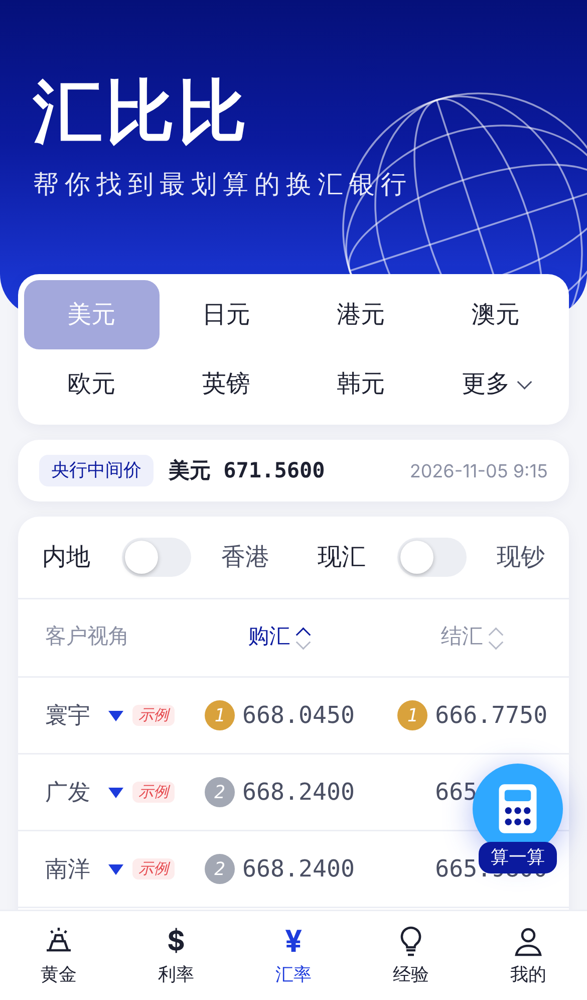
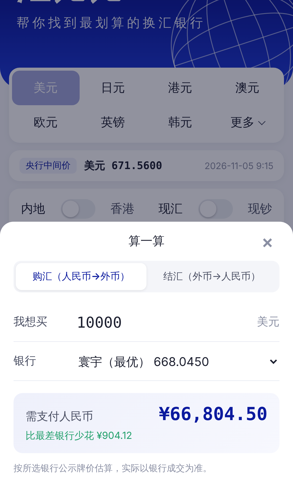
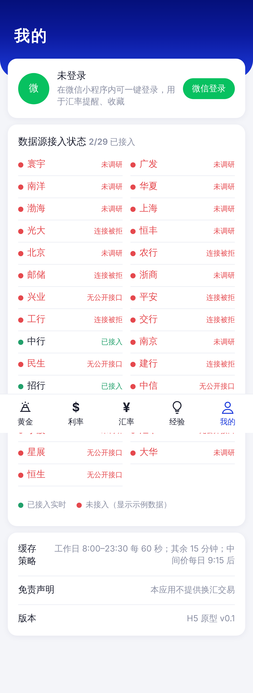

# 汇率兑换比价小程序：产品设计与研发架构方案

> 版本：v0.2 · 日期：2026-11-05
> 读者：产品、研发、以及后续接手实现的 Agent
> 参考对象：截图中的「银探——为你推荐最佳银行」微信小程序
> 变更：v0.2 记录已确认决策（第 0.1 节）、MVP 29 家银行接入状态（4.6，<span style="color:#e5484d">红色</span>=暂不能拉取）、缓存策略（7.3）、H5 原型（第 13 章）

---

## 0.1 已确认决策（2026-11-05）

| # | 决策 | 影响 |
|---|---|---|
| D1 | **MVP 采用官网公开页采集，不走付费 API**；按牌价变化频率设定缓存 | 删除 L2 付费备源，改为「官网采集 + 失败时展示上次值并标注」；缓存见 7.3 |
| D2 | 小程序主体**申请中** | 先开发 H5 移动版验证产品，主体/类目/备案下来后迁移小程序 |
| D3 | MVP 银行范围 = 两张参考截图银行并集，共 **29 家**；拉取不到的标红 | 见 4.6；当前仅 2 家可实时拉取，其余以**示例数据**占位 |
| D4 | **展示央行中间价** | 已接入 CFETS 公开 JSON；<span style="color:#e5484d">**正式上线前必须取得 CFETS 书面授权或改用授权信息商**</span>（见 4.3） |
| D5 | 小程序开发环境：云端容器无法运行微信开发者工具（GUI，仅 Win/macOS） | 先交付 H5 高保真可运行原型（第 13 章）；小程序工程在本地开发者工具中搭建 |

---

## 0. 给后续 Agent 的速读（TL;DR）

- **产品本质**：多家银行外汇牌价的**聚合与排名**工具（购汇/结汇比价），不做交易、不碰资金。
- **MVP 范围**：采集 5–8 家银行牌价 → 标准化入库 → 按币种/现汇现钞/购汇结汇排名 → 小程序展示 + 换算器 + 微信登录。
- **最大风险不是技术，是数据来源合规**：官方没有公开 API；银行网页可抓取但条款灰色；央行中间价（CFETS）商用需书面授权。详见第 4、10 章。
- **推荐技术栈**：小程序（Taro 或原生）+ FastAPI + PostgreSQL + Redis + 定时采集 Worker；部署在腾讯云（云托管 CloudRun）。
- **落地顺序**：见第 11 章里程碑与第 12 章 Agent 任务清单。
- **标 `【待验证】` 的内容**是调研中没有拿到官方证据的结论，实现前必须核实，不要当成事实。

---

## 1. 产品定位

| 项 | 内容 |
|---|---|
| 一句话 | 告诉用户「今天在哪家银行换汇最划算」 |
| 目标用户 | 留学生家长、出境旅游者、跨境电商/外贸小微、境外收入结汇人群 |
| 核心价值 | 省钱（价差可观，截图中美元购汇各银行相差约 0.5 分/美元 ~ 数分）；省时间（不用逐家查） |
| 商业模式（后续） | 导流（银行活动、外币现钞预约）、广告位、会员（高级提醒）。**MVP 不做变现** |
| 非目标 | 不提供换汇交易、不托管资金、不做投资建议、不做外汇保证金 |

### 1.1 截图功能拆解（竞品「银探」）

由截图可见：

1. **顶部币种 Tab**：美元、日元、港元、澳元、欧元、英镑、韩元、「更多」下拉。
2. **维度开关**：
   - 地区：内地 / 香港（开关，两类银行池）
   - 报价类型：现汇 / 现钞（开关）
3. **列表**：列头「客户视角」——购汇 / 结汇，两列均可点击升降序。
   - **购汇**：客户向银行买外币 = 银行**卖出价**，越低越好。
   - **结汇**：客户把外币卖给银行 = 银行**买入价**，越高越好。
   - 截图佐证：购汇列升序（668.0450 → 668.6080），结汇列最高者（666.7750）排第 1。
4. **排名徽章**：购汇前三名金/银/铜；并列名次相同（两家 668.2400 同为 2）。
5. **信息流插入位**：「15大结售汇技巧，90%人都搞错了！」（内容运营位，跳转经验 Tab）。
6. **悬浮入口**：「算一算」计算器。
7. **底部 Tab**：黄金、利率、**汇率**、经验、我的。
8. **价格单位**：人民币元 / 100 外币（668.0450 即 1 美元 ≈ 6.680450 元）。

> 注意：截图中银行名（寰宇、南洋等）是简称，具体对应哪家银行及其资质**【待验证】**，抓取前需逐家确认牌价来源页。

---

## 2. 功能模块

### 2.1 模块总览

```
┌────────────────────────── 小程序前端 ──────────────────────────┐
│ 汇率比价(首页) │ 换算器 │ 汇率提醒 │ 经验/资讯 │ 我的(登录/设置) │
└──────────────────────────────┬─────────────────────────────────┘
                               │ HTTPS / JSON
┌──────────────────────────────▼─────────────────────────────────┐
│ API 网关/应用层(FastAPI)：Rate API · Auth · Alert · Content     │
└───────┬───────────────┬───────────────┬────────────────────────┘
        │               │               │
   PostgreSQL         Redis        消息/任务队列
 (牌价/用户/提醒)   (热数据缓存)     (提醒推送、采集)
        ▲
┌───────┴──────────────── 数据采集与标准化层 ─────────────────────┐
│ Collector(每行一个适配器) → 校验/异常检测 → 标准化 → 入库/发布   │
└─────────────────────────────────────────────────────────────────┘
```

### 2.2 功能清单与优先级

| 优先级 | 模块 | 功能点 |
|---|---|---|
| P0 | 汇率比价 | 币种切换；内地/香港；现汇/现钞；购汇/结汇排序；排名徽章（含并列）；更新时间显示；数据新鲜度提示 |
| P0 | 换算器（算一算） | 金额 × 选定银行牌价；双向换算；选「最优银行」自动带入；结果注明「仅供参考，以银行实际成交为准」 |
| P0 | 账户 | 微信一键登录（匿名也可浏览，登录仅用于提醒/收藏） |
| P1 | 汇率提醒 | 设定币种+目标价+购汇/结汇；达到后订阅消息通知 |
| P1 | 银行详情 | 单行历史走势（7/30/90 天）、与最优价差、官网/网点跳转 |
| P1 | 经验/资讯 | 结售汇技巧文章（富文本/小程序内跳转公众号文章）；信息流插入 |
| P2 | 历史走势 | 各币种「全行业最优价」走势、最佳换汇时点（仅统计展示，不做预测） |
| P2 | 黄金/利率 | 截图底部 Tab，后续扩展；复用同一采集框架 |
| P2 | 分享/海报 | 分享今日最优价卡片 |
| P3 | 运营后台 | 数据源状态、异常告警、内容管理、AB 配置 |

### 2.3 关键交互规则（需精确实现）

1. **排序**：购汇按「银行卖出价」升序；结汇按「银行买入价」降序；缺失价格（银行不挂牌）沉底并显示「—」。
2. **并列**：同价同名次（1,2,2,4 的竞争排名；截图为 1,2,2,3 的稠密排名，**以截图为准采用稠密排名**）。徽章只给前 3 名。
3. **新鲜度**：数据超过 N 分钟（建议 30 分钟，可配）未更新则该行置灰并标注「xx 分钟前」；超过 24 小时不参与排名。
4. **单位**：数据库统一存「人民币元 / 1 外币」的 `DECIMAL(18,6)`；展示层按币种习惯转为 /100（与银行页保持一致，便于用户核对）。**日元、韩元等需特别注意银行原始单位**。
5. **免责**：所有页面固定展示牌价为银行公示价、非成交价，实际以柜台/手机银行为准。

---

## 3. 关键业务概念

| 概念 | 说明 |
|---|---|
| 现汇 | 账户内的外汇（电子形态）。买入/卖出价差较小 |
| 现钞 | 实物外币纸币。价差通常更大（银行要承担运保、点钞成本） |
| 买入价（银行视角） | 银行买外币；用户**结汇**时适用 |
| 卖出价（银行视角） | 银行卖外币；用户**购汇**时适用 |
| 中间价/折算价 | 央行中间价（CFETS 发布）；银行也会发布「折算价」（如中行折算价） |
| 报价单位 | 多数银行以「每 100 外币折合人民币」报价；个别币种（如港元）可能以每 10 或每 100 等不同单位，**必须在适配器里显式配置**（招行接口里出现 `ccyExc` 字段，疑似单位，**【待验证】**） |

标准化公式：

```
price_cny_per_unit = raw_price / unit_divisor      # unit_divisor 如 100
```

---

## 4. 数据来源调研（核心）

> 结论先行：**没有任何一家银行提供面向第三方的官方、免费、带 SLA 的牌价 API**。可行方案分四类：银行官网页面采集、第三方聚合 API、授权数据服务、与银行/渠道合作。

### 4.1 已验证（本次调研实测，2026-11-05）

以下仅做了**普通 GET 请求**，未做任何反爬规避。

| 数据源 | 形态 | 实测结果 | 字段说明 |
|---|---|---|---|
| 中国银行外汇牌价 `https://www.boc.cn/sourcedb/whpj/` | 服务端渲染 HTML 表格（`<table id="priceTable">`） | HTTP 200，约 30KB，可解析 | 货币名称 / 现汇买入价 / 现钞买入价 / 现汇卖出价 / 现钞卖出价 / 中行折算价 / 发布日期 / 发布时间；行上带 `data-currency` 属性。单位：人民币/100 外币。历史牌价另有检索页（`whpjSearch`）。 |
| 招商银行 `https://fx.cmbchina.com/api/v1/fx/rate` | 公开 JSON（页面前端调用的接口） | HTTP 200，返回 10 个币种：港币、新西兰元、澳元、美元、欧元、加元、英镑、日元、新加坡元、瑞士法郎 | 示例（美元）：`rthBid=665.996` `rthOfr=668.898` `rtcBid=665.996` `rtcOfr=668.898` `rtbBid=667.230` `ratTim=15:48:35` `ratDat=2026年11月05日` `ccyExc=10`。推断：`rth*`=现汇、`rtc*`=现钞，`Bid`=银行买入，`Ofr`=银行卖出，`rtbBid`=折算价；**该映射为推断，【待验证】**。注意：不含韩元。 |
| 中国外汇交易中心（CFETS）`chinamoney.com.cn` 中间价 JSON | 网站前端 JSON | HTTP 200 可访问 | **但官网声明商用须书面授权**，见 4.3。仅用于理解，不可直接接入生产。 |

### 4.2 未验证 / 受限（需要下一步工作）

| 数据源 | 状态 |
|---|---|
| 农业银行 | 访问官网牌价页返回 302 跳转，未跟进，**【待验证】**；网上有其 `ewealth.abchina.com` 数据服务路径的说法，未核实 |
| 工商银行 | 一次探测请求因带了伪造浏览器头被安全策略拦截，**未获得结论**。后续应在合规前提下（见 4.5）重新评估，**不得通过伪造 UA/Referer、绕过验证码等方式规避反爬** |
| 建设银行、交通银行、浦发、光大、广发、华夏、渤海、恒丰、北京银行、上海银行等 | 本次未探测，需逐家评估页面形态（HTML / JSON / 需 App 内 H5 / 需登录） |
| 香港银行（南洋商业银行等） | 未探测。需明确是否确为香港银行牌价及发布页面 |
| 部分银行可能仅在 App 内展示 | 无法通过网页获取，只能走合作或第三方 |

### 4.3 授权类数据（央行中间价 / 市场数据）

- CFETS 官网声明：任何机构或个人使用其市场数据，须申请并取得书面授权；未经书面许可不得复制、传播、发布、出售或基于其做衍生品。信息服务机构需具备营业执照、相关金融资质、技术能力等条件。
- 结论：**若产品要展示「央行中间价」，必须走授权或通过已授权的第三方信息商获取**；MVP 可以先不展示中间价，用「各行折算价/中间价」或不展示。
- 联系方式（据官网搜索结果）：CFETS 数据服务（chinamoney.com.cn 上有联系渠道）。**【待验证】**

### 4.4 第三方聚合 API

| 服务 | 说明 | 评估 |
|---|---|---|
| 天聚数行 TianAPI「银行外汇牌价」 | 覆盖工行、中行、招行等多家，可按币种查询；需 Key，按次计费（新用户有试用额度） | 接入快，适合 MVP 兜底/校验；成本随请求量增长；覆盖银行数、更新频率、SLA、可否商用需看合同 **【待验证】** |
| 其他聚合平台（聚合数据、阿里云市场、腾讯云市场等） | 同类产品 | 需逐一询价，比较覆盖银行、更新延迟、是否允许缓存与二次分发 |
| 开源爬虫：`sarkrui/BankExRateSpider`、`bobleer/bocfx`（中行 PyPI 包） | 自称支持中行、农行、兴业、招行等 | **只作为解析思路参考**；依赖页面结构、维护状态未验证；不建议直接依赖其代码上生产（license 与稳定性） |

### 4.5 数据获取策略（推荐）

采用**分层数据源 + 可替换适配器**，避免被单一来源卡死：

| 层 | 来源 | 用途 |
|---|---|---|
| L1（主） | 银行官网公开牌价页面/接口，低频、礼貌采集 | 主数据，实时性最好、成本最低 |
| L2（备/校验） | 付费聚合 API | L1 失败时兜底；与 L1 交叉校验发现异常 |
| L3（长期） | 与银行/渠道商务合作（导流分成换取数据授权） | 合规、稳定，产品起量后推进 |
| 授权 | CFETS 中间价 | 仅在取得授权后展示 |

> v0.2 决策 D1：MVP 不使用 L2 付费 API。采集失败时展示最后一次成功值，并标注获取时间。

**合规与采集守则**（必须写入代码规范）：

1. 采集前阅读每家站点的使用条款与 `robots.txt`，**记录结论存档**；有明确禁止的一律不抓，改走 L2/L3。
2. 只采集**公开页面、未登录、无验证码**的数据；**严禁**伪造身份头、绕过验证码/风控、使用代理池规避封禁。
3. 低频：每家每币种集合 ≥ 60 秒一次（银行牌价通常分钟级甚至小时级变动，没必要更快）；带明确 UA（含联系方式）；遵守 `ETag/Last-Modified`；失败指数退避。
4. 展示注明数据来源与更新时间；收到银行下线要求时 24 小时内响应。
5. 法律风险（反不正当竞争、数据权益）由法务评估，产品上线前出具意见。**本文不构成法律意见。**

### 4.6 MVP 银行清单与接入状态（两张截图并集，29 家）

测试方式：2026-11-05 从本开发容器（境外云主机）发起**普通 GET**（不伪造请求头）。<span style="color:#e5484d">红色</span>表示**当前不能拉取**，原型中以示例数据（截图价格）占位，并在界面标注「示例」。

状态说明：
- **已接入**：公开数据源已验证，解析器和单测已完成。
- **连接被拒**：官网对本测试主机直接重置连接（`Connection reset by peer`）。**很可能是银行屏蔽境外/机房 IP**，需在**境内服务器**（如腾讯云上海/广州）复测，复测后有望转为可拉取。
- **无公开接口**：官网首页可访问，但尚未找到公开牌价页或接口地址。需人工在官网/手机银行 H5 中定位牌价页。
- **未调研**：尚未定位官网牌价页；部分银行全称也待确认。

| # | 简称 | 银行 | 状态 | 数据源 / 备注 |
|---|---|---|---|---|
| 1 | 中行 | 中国银行 | 已接入 | `boc.cn/sourcedb/whpj/` HTML 表格，45 个币种；「中行折算价」= 央行中间价 ×100（已用 CFETS 数据交叉校验） |
| 2 | 招行 | 招商银行 | 已接入 | `fx.cmbchina.com/api/v1/fx/rate` JSON，10 个币种（无韩元）；单位为每 100 外币（已与中行对比，日元也是每 100）；`ccyExc=10` 含义未知，不是单位 |
| 3 | 工行 | 中国工商银行 | <span style="color:#e5484d">连接被拒</span> | 需在境内复测 |
| 4 | 农行 | 中国农业银行 | <span style="color:#e5484d">连接被拒</span> | 需在境内复测 |
| 5 | 建行 | 中国建设银行 | <span style="color:#e5484d">连接被拒</span> | 需在境内复测 |
| 6 | 交行 | 交通银行 | <span style="color:#e5484d">连接被拒</span> | 需在境内复测 |
| 7 | 邮储 | 中国邮政储蓄银行 | <span style="color:#e5484d">连接被拒</span> | 需在境内复测 |
| 8 | 光大 | 中国光大银行 | <span style="color:#e5484d">连接被拒</span> | 需在境内复测 |
| 9 | 浦发 | 上海浦东发展银行 | <span style="color:#e5484d">连接被拒</span> | 需在境内复测 |
| 10 | 平安 | 平安银行 | <span style="color:#e5484d">连接被拒</span> | 需在境内复测 |
| 11 | 中信 | 中信银行 | <span style="color:#e5484d">无公开接口</span> | 官网可访问，牌价页待定位 |
| 12 | 民生 | 中国民生银行 | <span style="color:#e5484d">无公开接口</span> | 官网可访问，牌价页待定位 |
| 13 | 兴业 | 兴业银行 | <span style="color:#e5484d">无公开接口</span> | 官网可访问，牌价页待定位 |
| 14 | 汇丰 | 汇丰银行（中国） | <span style="color:#e5484d">无公开接口</span> | 官网可访问，牌价页待定位 |
| 15 | 恒生 | 恒生银行（中国） | <span style="color:#e5484d">无公开接口</span> | 官网可访问，牌价页待定位 |
| 16 | 星展 | 星展银行（中国） | <span style="color:#e5484d">无公开接口</span> | 官网可访问，牌价页待定位 |
| 17 | 寰宇 | 全称待确认 | <span style="color:#e5484d">未调研</span> | 截图中购汇、结汇均第 1，需先确认是哪家机构 |
| 18 | 广发 | 广发银行 | <span style="color:#e5484d">未调研</span> | |
| 19 | 南洋 | 南洋商业银行（中国） | <span style="color:#e5484d">未调研</span> | 出现在「内地」列表，推断为内地法人行 |
| 20 | 华夏 | 华夏银行 | <span style="color:#e5484d">未调研</span> | |
| 21 | 渤海 | 渤海银行 | <span style="color:#e5484d">未调研</span> | |
| 22 | 上海 | 上海银行 | <span style="color:#e5484d">未调研</span> | |
| 23 | 恒丰 | 恒丰银行 | <span style="color:#e5484d">未调研</span> | |
| 24 | 北京 | 北京银行 | <span style="color:#e5484d">未调研</span> | |
| 25 | 浙商 | 浙商银行 | <span style="color:#e5484d">未调研</span> | |
| 26 | 南京 | 南京银行 | <span style="color:#e5484d">未调研</span> | |
| 27 | 杭州 | 杭州银行 | <span style="color:#e5484d">未调研</span> | |
| 28 | 宁波 | 宁波银行 | <span style="color:#e5484d">未调研</span> | |
| 29 | 大华 | 大华银行（中国） | <span style="color:#e5484d">未调研</span> | |

汇总：**已接入 2 家**；<span style="color:#e5484d">连接被拒 8 家、无公开接口 6 家、未调研 13 家</span>。

另外：
- **香港银行池**（截图中的「内地/香港」开关）：本期截图都是内地列表，香港银行清单与数据源**尚未定义**，原型中显示「接入中」空状态。
- **截图里部分数字被悬浮按钮遮挡**（渤海、上海、浦发、杭州的结汇价），示例数据用可见位补 0，仅作演示。
- **下一步**：在境内服务器上对 8 家「连接被拒」的银行复测；再逐家定位 6 家「无公开接口」和 13 家「未调研」银行的牌价页。每家都需填写条款/robots 评估。

---

## 5. 数据模型

### 5.1 ER 概览

```
bank ──< bank_source ──< raw_snapshot
 │
 └──< rate_quote >── currency
 
user ──< alert_rule ──< alert_event
user ──< favorite
content_article
```

### 5.2 表结构（PostgreSQL）

```sql
-- 银行
CREATE TABLE bank (
  id           SERIAL PRIMARY KEY,
  code         VARCHAR(32) UNIQUE NOT NULL,   -- boc, cmb, icbc ...
  name_cn      VARCHAR(64) NOT NULL,
  short_name   VARCHAR(16) NOT NULL,           -- 展示用简称（如 "招行"）
  region       VARCHAR(8) NOT NULL,            -- mainland | hk
  logo_url     TEXT,
  website      TEXT,
  enabled      BOOLEAN DEFAULT TRUE,
  sort_weight  INT DEFAULT 0
);

-- 币种
CREATE TABLE currency (
  code         CHAR(3) PRIMARY KEY,            -- USD, JPY, HKD ...
  name_cn      VARCHAR(16) NOT NULL,
  quote_unit   INT NOT NULL DEFAULT 100,       -- 行业惯例展示单位（/100）
  sort_weight  INT DEFAULT 0,
  enabled      BOOLEAN DEFAULT TRUE
);

-- 数据源配置（每行可有多个来源，按 priority 回退）
CREATE TABLE bank_source (
  id           SERIAL PRIMARY KEY,
  bank_id      INT REFERENCES bank(id),
  kind         VARCHAR(16) NOT NULL,           -- html | json | aggregator
  url          TEXT NOT NULL,
  adapter      VARCHAR(64) NOT NULL,           -- 适配器类名
  priority     INT DEFAULT 1,                  -- 1=主, 2=备
  interval_sec INT DEFAULT 120,
  terms_note   TEXT,                           -- 条款/robots 评估结论
  enabled      BOOLEAN DEFAULT TRUE
);

-- 原始快照（审计/回放/改版排查），保留 14~30 天
CREATE TABLE raw_snapshot (
  id           BIGSERIAL PRIMARY KEY,
  source_id    INT REFERENCES bank_source(id),
  fetched_at   TIMESTAMPTZ NOT NULL,
  http_status  INT,
  content_hash CHAR(64),
  body_ref     TEXT                            -- 对象存储路径，不直接存大文本
);

-- 标准化牌价（时间序列，核心表）
CREATE TABLE rate_quote (
  id             BIGSERIAL PRIMARY KEY,
  bank_id        INT NOT NULL REFERENCES bank(id),
  currency       CHAR(3) NOT NULL REFERENCES currency(code),
  spot_buy       NUMERIC(18,6),   -- 现汇买入（银行买入，结汇用）CNY/1外币
  spot_sell      NUMERIC(18,6),   -- 现汇卖出（银行卖出，购汇用）
  cash_buy       NUMERIC(18,6),   -- 现钞买入
  cash_sell      NUMERIC(18,6),   -- 现钞卖出
  mid_price      NUMERIC(18,6),   -- 折算价/中间价（可空）
  published_at   TIMESTAMPTZ,     -- 银行页面标注的发布时间
  fetched_at     TIMESTAMPTZ NOT NULL,
  source_id      INT REFERENCES bank_source(id),
  UNIQUE (bank_id, currency, published_at)
);
CREATE INDEX ON rate_quote (currency, fetched_at DESC);
CREATE INDEX ON rate_quote (bank_id, currency, fetched_at DESC);

-- 最新牌价（物化/普通表，API 读取走这里 + Redis）
CREATE TABLE rate_latest (
  bank_id INT, currency CHAR(3),
  spot_buy NUMERIC(18,6), spot_sell NUMERIC(18,6),
  cash_buy NUMERIC(18,6), cash_sell NUMERIC(18,6),
  mid_price NUMERIC(18,6),
  published_at TIMESTAMPTZ, fetched_at TIMESTAMPTZ,
  PRIMARY KEY (bank_id, currency)
);

-- 用户
CREATE TABLE app_user (
  id          BIGSERIAL PRIMARY KEY,
  openid      VARCHAR(64) UNIQUE NOT NULL,
  unionid     VARCHAR(64),                      -- 仅绑定开放平台后才有
  nickname    VARCHAR(64),
  avatar_url  TEXT,
  created_at  TIMESTAMPTZ DEFAULT now(),
  last_login  TIMESTAMPTZ
);

-- 提醒规则
CREATE TABLE alert_rule (
  id          BIGSERIAL PRIMARY KEY,
  user_id     BIGINT REFERENCES app_user(id),
  currency    CHAR(3) NOT NULL,
  direction   VARCHAR(8) NOT NULL,              -- buy(购汇) | sell(结汇)
  channel     VARCHAR(8) NOT NULL,              -- spot | cash
  region      VARCHAR(8) NOT NULL,
  op          VARCHAR(4) NOT NULL,              -- lte | gte
  target      NUMERIC(18,6) NOT NULL,           -- CNY/1外币
  status      VARCHAR(8) DEFAULT 'active',      -- active | triggered | paused
  sub_quota   INT DEFAULT 0,                    -- 剩余可发订阅消息次数
  created_at  TIMESTAMPTZ DEFAULT now()
);

CREATE TABLE alert_event (
  id BIGSERIAL PRIMARY KEY, rule_id BIGINT, bank_id INT,
  price NUMERIC(18,6), sent_at TIMESTAMPTZ, result VARCHAR(16)
);

CREATE TABLE favorite (user_id BIGINT, bank_id INT, currency CHAR(3),
  PRIMARY KEY(user_id, bank_id, currency));
```

数据量估算：10 家银行 × 15 币种 × 每 2 分钟 ≈ 100 万行/月（去重只写变化后更少）。PostgreSQL 足够；若后续扩展黄金/利率与更高频，可上 TimescaleDB。

---

## 6. 采集与标准化设计

### 6.1 适配器接口

```python
class BankAdapter(Protocol):
    bank_code: str
    def fetch(self) -> RawPayload: ...            # HTTP GET，带 UA、超时、重试
    def parse(self, raw: RawPayload) -> list[Quote]: ...  # 纯函数，便于单测与回放

@dataclass
class Quote:
    bank_code: str
    currency: str            # ISO 4217
    spot_buy: Decimal | None
    spot_sell: Decimal | None
    cash_buy: Decimal | None
    cash_sell: Decimal | None
    mid_price: Decimal | None
    published_at: datetime | None
    unit: int                # 原始报价单位，如 100
```

约定：
- `parse` 必须是**纯函数**，样例 HTML/JSON 放 `tests/fixtures/<bank>/`，改版后用快照做回归。
- 币种名 → ISO 码用映射表（"美元" → USD；"港币"/"港元" 都映射 HKD）。
- 空串、`--`、`0` 视为缺失，不是 0。

### 6.2 采集流水线

```
Scheduler(APScheduler / Celery beat)
   └─▶ 每个 bank_source 按 interval 触发 fetch
         ├─ 失败 → 指数退避 + 切换 priority=2 的备源 + 告警计数
         └─ 成功 → 存 raw_snapshot(hash 去重) → parse → 校验
                    ├─ 校验失败(异常值) → 丢弃 + 告警，保留上一版
                    └─ 通过 → 标准化(单位换算) → upsert rate_latest
                              → 变化时 insert rate_quote → 刷新 Redis
                              → 发布「牌价变化」事件 → 提醒引擎
```

### 6.3 数据质量校验（必做）

| 校验 | 规则 |
|---|---|
| 价差合理性 | `sell ≥ buy`；`(sell-buy)/mid` 在 [0, 5%]（现钞可放宽）；否则标异常 |
| 跳变 | 与上一版相比变动 > 3%（日内）直接拒收并告警，人工确认后放行 |
| 跨行离群 | 同币种各行折算价与全行业中位数偏差 > 2% 视为离群 |
| 新鲜度 | `published_at` 不单调回退；长时间不变也告警（页面卡住） |
| 结构变化 | 解析出的币种数 < 上次的 50% → 疑似改版，立即告警并停止覆盖旧数据 |

### 6.4 排名算法

```python
def rank(quotes, direction, channel):
    key = 'sell' if direction == 'buy' else 'buy'   # 购汇看卖出价；结汇看买入价
    price = lambda q: getattr(q, f"{'spot' if channel=='spot' else 'cash'}_{key}")
    valid = [q for q in quotes if price(q) is not None and q.fresh]
    asc = (direction == 'buy')                       # 购汇升序，结汇降序
    valid.sort(key=price, reverse=not asc)
    # 稠密排名（并列同名次）：1,2,2,3
    ...
```

提示：购汇与结汇**分别**排名（截图两列各有徽章）。

---

## 7. 技术架构

### 7.1 选型

| 层 | 选型 | 理由 |
|---|---|---|
| 小程序 | Taro + React + TS（或原生 + TS） | 便于日后扩展 H5/支付宝；原生更省包体，MVP 可原生 |
| 后端 | Python 3.11 + FastAPI | 采集/解析生态好；与团队现有 Python 代码一致 |
| 数据库 | PostgreSQL 15 | 关系 + 时序够用 |
| 缓存 | Redis | 最新牌价、排名结果、限流、session |
| 任务 | APScheduler（单实例）→ Celery/RQ（多实例） | 采集、提醒推送 |
| 对象存储 | 腾讯云 COS | 原始快照、图片 |
| 部署 | 腾讯云微信云托管（CloudRun）或 CVM + Docker | 云托管与小程序鉴权天然打通，**免公网备案域名的一部分麻烦**【待验证，以平台当前规则为准】 |
| 监控 | Prometheus + Grafana 或云监控；Sentry | 采集成功率、新鲜度、异常告警 |
| 告警渠道 | 企业微信机器人 / 邮件 | 数据异常第一时间触达 |

### 7.2 API 设计（REST，前缀 `/api/v1`）

| 方法 路径 | 说明 |
|---|---|
| `GET /currencies` | 币种列表（含排序、更多下拉） |
| `GET /rates?currency=USD&region=mainland&channel=spot` | 返回各行最新价 + 两个方向的排名 + 更新时间 + 新鲜度标志 |
| `GET /rates/{bank}/{currency}/history?range=30d` | 单行历史 |
| `GET /rates/best/history?currency=USD&direction=buy&range=90d` | 全行业最优价走势 |
| `POST /convert` | `{from,to,amount,bank?,direction,channel}` → 结果（后端也提供，便于口径一致） |
| `POST /auth/login` | `{code}` → code2Session → 签发 JWT |
| `GET/POST/DELETE /alerts` | 提醒规则管理（需登录） |
| `POST /alerts/subscribe-ack` | 前端授权订阅消息后回传，增加 quota |
| `GET /articles` / `GET /articles/{id}` | 经验文章 |
| `GET /health` `GET /admin/sources` | 运维 |

`/rates` 响应示意：

```json
{
  "currency": "USD", "region": "mainland", "channel": "spot", "unit": 100,
  "updated_at": "2026-11-05T15:42:10+08:00",
  "banks": [
    {"bank":"cmb","name":"招行","buy":665.996,"sell":668.898,
     "buy_rank":9,"sell_rank":14,"published_at":"15:48:35","stale":false}
  ]
}
```

性能目标：`/rates` P95 < 150ms（Redis 命中）；首屏 < 1s；单实例 500 QPS 读。

### 7.3 缓存策略（按牌价变化频率，v0.2 已实现于原型）

观测依据：中行、招行牌价在白天**分钟级**更新（实测两家的发布时间都在几分钟内刷新），夜间和周末基本不动；央行中间价**每个交易日 9:15** 发布一次。

| 数据 | 时段（北京时间） | 刷新间隔 / TTL |
|---|---|---|
| 银行牌价 | 工作日 08:00–23:30 | **60 秒** |
| 银行牌价 | 夜间、周末 | **15 分钟** |
| 银行牌价 | 抓取失败 | 30 秒后重试，期间**继续返回上次成功值**（stale-while-error） |
| 央行中间价 | 全天 | 缓存到**次日 09:20**（9:15 发布，留 5 分钟余量） |
| 前端 | — | 按接口返回的 `cache_ttl` 自动轮询，不额外加压 |

上线时的演进：
- 原型用的是进程内缓存；多实例部署时改为 Redis，采集写入后**主动刷新**（key：`rates:{region}:{currency}:{channel}`，TTL 5 分钟兜底）。
- 由独立 Worker 采集，不在用户请求时触发。
- 小程序端本地缓存上次响应，弱网先展示旧数据并标「更新中」。
- 配置 Nginx/网关对 `/rates` 加 10–30 秒微缓存抵御突发。

### 7.4 安全

- 域名需 HTTPS，并在小程序后台配置**request 合法域名**。
- `AppSecret`、聚合 API Key 只放服务端环境变量/密钥管理，**不得进入小程序包或仓库**（仓库已有 `.env.example` 习惯，保持）。
- JWT 短期有效（如 2 小时）+ refresh；接口限流（IP + 用户）。
- 日志不落 `session_key`、手机号等敏感信息。

---

## 8. 微信小程序账户与平台管理

> 本节关于微信官方规则的部分，只有 `code2Session` 是本次调研确认的；类目、主体、备案、订阅消息相关的描述基于一般了解，**均标【待验证】，上线前以微信公众平台与工信部当前文档为准**。

### 8.1 账号主体与类目

| 事项 | 建议 |
|---|---|
| 主体类型 | **企业主体**（建议）。个人主体可做的类目有限，且未来涉及广告/导流/金融信息时受限【待验证】 |
| 服务类目 | 优先选「工具类 → 信息查询/计算」之类，**避免被判定为金融交易类**；功能描述中写明「仅提供公开牌价信息比对，不提供外汇交易」【待验证】 |
| 内容红线 | 不出现「买入/卖出下单」按钮、不承诺收益、不做汇率预测式荐股口吻 |
| 备案 | 面向境内用户的小程序需完成**小程序备案（ICP）**【待验证】；备案周期纳入排期，通常需数周 |
| 隐私 | 配置「用户隐私保护指引」，声明收集的信息（openid、昵称头像、订阅消息）；仅在用到时才申请授权 |
| 认证 | 完成微信认证（企业认证需缴费），以便使用更多能力与展示主体信息【待验证】 |

### 8.2 登录与用户体系

已确认流程（官方 `code2Session`）：

```
小程序 wx.login() ─▶ code
   └─▶ POST /auth/login {code}
         └─▶ 服务端 GET https://api.weixin.qq.com/sns/jscode2session
                 ?appid=APPID&secret=SECRET&js_code=CODE&grant_type=authorization_code
              返回 openid、session_key、(unionid)
         └─▶ upsert app_user(openid) → 签发 JWT 给小程序
```

要点：
- 该接口**只能服务端调用**，不能在前端直接请求。
- `openid`：用户在当前小程序内唯一标识。`unionid`：**仅当小程序已绑定微信开放平台账号**时返回，用于将来与公众号/App 打通用户。若有公众号运营（经验文章）计划，建议**第一天就绑定开放平台**。
- `session_key` 仅服务端保存、**不下发给前端**；MVP 不需要解密手机号等数据，可不存。
- 常见错误码：`40029` code 无效；`45011` 频率限制；`40226` 高风险用户拦截 —— 需有对应友好提示。
- 浏览比价**无需登录**；仅「提醒/收藏/历史」需要登录，降低首次使用门槛。
- 头像昵称：使用微信当前推荐的头像昵称填写组件由用户主动填写，不强制。

### 8.3 订阅消息（汇率提醒）

- 小程序只能通过**订阅消息**主动触达用户，需用户在小程序内**逐次授权**（`wx.requestSubscribeMessage`）。一次性订阅每授权一次可发一条【待验证】。
- 设计：设置提醒时弹授权 → 授权成功 `sub_quota += 1` → 条件触发时消耗配额发送，配额为 0 时在「我的」里提示「提醒已触发但无法推送，请重新授权」。
- 模板：在公众平台申请模板（如「价格提醒」类），字段：币种、目标价、当前最优价、银行、时间。模板可选范围随类目而定【待验证】。
- 防骚扰：同一规则触发后置为 `triggered`，需用户重新开启；每用户每日最多 N 条。

### 8.4 版本与发布

- 开发版 / 体验版 / 审核版 / 线上版；CI 使用 `miniprogram-ci` 自动上传体验版。
- 灰度：使用微信后台「分阶段发布」。
- 审核要点准备：类目资质说明、隐私指引、数据来源说明、免责声明截图。

---

## 9. 前端页面结构

```
pages/
  index/        汇率比价（币种Tab、内地/香港、现汇/现钞、购汇/结汇列表、悬浮「算一算」）
  convert/      换算器（也可做成半屏弹层）
  bank/         银行详情（走势图、最优价差）
  alerts/       提醒列表 & 新建
  articles/     经验列表 / 详情
  mine/         登录、收藏、设置、隐私与免责声明
components/
  rate-row, rank-badge, currency-tabs, toggle, freshness-tag, line-chart(ec-canvas / F2)
```

要点：
- 价格数字使用等宽/tabular 数字字体，列对齐（参考截图）。
- 列表行点击进入银行详情；信息流位（运营内容）可配置插入位置（截图在第 3 行后）。
- 图表库选 `ec-canvas`（ECharts 小程序版）或 F2；注意主包 2MB 限制，图表走分包。

---

## 10. 风险清单

| # | 风险 | 级别 | 应对 |
|---|---|---|---|
| 1 | 银行页面改版/限流导致采集失败 | 高 | 适配器 + 快照回归 + 备用聚合 API + 告警；解析结构变化即停止覆盖旧数据 |
| 2 | 数据来源合规（条款、反不正当竞争） | 高 | 逐家评估并存档；禁止规避反爬；长期走商务合作；法务出具意见 |
| 3 | 展示错误价格造成用户损失/投诉 | 高 | 校验与跳变拦截；新鲜度提示；醒目免责；错误数据一键下线开关 |
| 4 | 央行中间价商用授权 | 中 | MVP 不展示；确需展示走授权信息商 |
| 5 | 小程序类目/资质审核被拒（被判金融类） | 中 | 提前阅读类目规则、功能表述去交易化；准备申诉材料 |
| 6 | 小程序备案/域名周期 | 中 | 项目启动即并行办理 |
| 7 | 聚合 API 成本失控 | 低 | 仅作兜底，缓存复用，按量监控 |
| 8 | 香港银行/部分银行牌价口径与币种单位不一 | 中 | 适配器显式配置单位，单测覆盖 |
| 9 | 提醒配额耗尽（订阅消息机制限制） | 中 | UI 引导重新授权；考虑引导关注公众号做补充触达【待验证】 |

---

## 11. 里程碑

| 阶段 | 周期（估） | 交付 |
|---|---|---|
| M0 调研收尾 | 1 周 | 逐家银行数据源评估表（形态、条款、单位、字段映射）；类目/备案咨询结论；聚合 API 选型报价 |
| M1 采集 MVP | 1–2 周 | 中行 + 招行适配器（已验证形态）+ 1 家聚合 API 备源；入库、校验、告警；`/rates` API |
| M2 小程序 MVP | 2 周 | 比价首页、换算器、登录；体验版 |
| M3 扩源 + 提醒 | 2 周 | 扩到 6–8 家银行；订阅消息提醒；历史走势 |
| M4 上线 | 1–2 周 | 备案/审核/隐私指引；灰度；监控看板 |
| M5 运营 | 持续 | 经验内容、黄金/利率、商务合作拿官方数据 |

---

## 12. 给后续 Agent 的任务清单

建议仓库结构（新建，不要污染现有 `server.py` / `index.html`——它们属于另一个已有项目）：

```
today-x/
  docs/exchange-rate-miniprogram-design.md   # 本文
  fx-backend/
    app/ (api, models, services, adapters/, jobs/)
    tests/fixtures/{boc,cmb,...}/
    alembic/
    Dockerfile  docker-compose.yml
  fx-miniprogram/
```

任务（按序，每项独立可验收）：

1. **T1 建库与模型**：按第 5 章建 SQLAlchemy 模型 + Alembic 迁移 + 币种/银行种子数据。*验收*：迁移可正反向执行。
2. **T2 BOC 适配器**：解析 `https://www.boc.cn/sourcedb/whpj/` 的 `#priceTable`；保存样例 HTML 为 fixture；单位 /100。*验收*：fixture 单测通过；缺失值为 `None`。
3. **T3 CMB 适配器**：解析 `https://fx.cmbchina.com/api/v1/fx/rate`；**先核实字段映射与 `ccyExc` 含义**（对比招行官网页面显示），把结论写回本文 4.1。
4. **T4 采集框架**：调度、重试、退避、快照、校验（6.3）、upsert、Redis 刷新、告警钩子。
5. **T5 `/rates` 与排名**：实现 6.4 稠密排名，购汇/结汇分别排名；新鲜度标记。*验收*：并列/缺失/过期用例。
6. **T6 `/auth/login`**：code2Session、JWT；AppSecret 走环境变量；错误码映射。
7. **T7 小程序首页**：按截图还原（币种 Tab、两个开关、两列排序、徽章、悬浮「算一算」）。
8. **T8 换算器、提醒、历史走势**。
9. **T9 其余银行适配器**：每家先填「评估表」（形态/条款/robots/单位），**条款不允许的不实现，改走聚合源**。
10. **T10 聚合 API 备源适配器**与交叉校验任务。
11. **T11 监控与运营后台最小集**：数据源状态页、手动下线某行/某币种。

**硬性约束**：
- 禁止伪造 UA/Referer、绕过验证码或风控、使用代理池规避限制。
- 采集间隔 ≥ 60 秒；所有密钥放环境变量。
- 价格一律使用 `Decimal`，不得用 float 计算。
- 不确定的字段含义（标【待验证】）先核实，再编码。

---

## 13. H5 高保真原型（v0.2 已交付）与小程序开发环境

### 13.1 为什么先做 H5

- 微信开发者工具是 Windows/macOS 图形界面软件，本项目所在的云端开发容器**无法运行和预览**小程序。
- 小程序主体仍在申请中，没有正式 AppID（开发者工具可以先用「测试号」）。
- 因此先交付**移动端 H5 高保真可运行原型**，接真实后端数据，用于产品评审和验证交互；后端 API 与小程序共用。

### 13.2 原型代码位置与运行

```
fx-app/
  backend/      FastAPI：adapters.py（中行/招行/CFETS 解析）、service.py（缓存/排名/示例数据）、app.py（API + 静态页）
  web/          H5：index.html / style.css / app.js（原生 JS，无构建步骤）
  tests/        pytest + 真实页面快照 fixtures
  docs/screenshots/   原型截图
```

```bash
pip install -r fx-app/backend/requirements.txt
```

```bash
cd fx-app/backend && uvicorn app:app --host 0.0.0.0 --port 8000
```

浏览器打开 `http://localhost:8000`，用手机模式查看。

### 13.3 已实现功能

| 功能 | 说明 |
|---|---|
| 币种 Tab + 更多 | 7 个主币种 + 「更多」底部弹层（共 12 个） |
| 央行中间价条 | 当前币种的 CFETS 中间价与发布时间 |
| 内地/香港、现汇/现钞开关 | 香港池显示「接入中」空状态 |
| 购汇/结汇排序 | 默认最优在前；再次点击切换升降序 |
| 排名徽章 | 购汇、结汇分别做稠密排名，前 3 名金/银/铜 |
| 实时 / 示例标签 | 中行、招行为「实时」；其余 27 家标红色「示例」 |
| 行展开详情 | 全称、数据来源与发布时间、换 1 万外币比最优多付/少收多少、相对中间价的点差 |
| 算一算 | 购汇/结汇双向，默认选最优银行，显示比最差银行省多少 |
| 我的 | 微信登录占位、29 家数据源接入状态（红/绿）、缓存策略说明 |
| 自动刷新 | 按后端 `cache_ttl` 轮询 |

原型截图（iPhone 13 尺寸，后端已接实时数据）：

<p>



</p>

**示例数据口径**：美元直接使用截图价格；其他币种由「中行实时价 × 该行美元相对中行的价差比例」**合成**，仅供演示界面，不代表真实牌价。

### 13.4 迁移到小程序（主体下来后）

1. 在本地安装微信开发者工具，先用测试号创建工程，选 Taro（React）或原生。
2. 把 `web/app.js` 的状态和渲染逻辑迁到页面组件；接口不变（`/api/v1/*`）。
3. 后端部署到**境内**服务器（同时解决 4.6 的「连接被拒」复测），配置 HTTPS 和 request 合法域名。
4. 接入 `wx.login` → `/auth/login`（第 8 章）。

---

## 附录 A：调研来源与说明

- 中国银行外汇牌价页（实测）：https://www.boc.cn/sourcedb/whpj/
- 招商银行外汇牌价接口（实测，页面前端调用）：https://fx.cmbchina.com/api/v1/fx/rate
- CFETS 中国货币网（数据使用需授权）：https://www.chinamoney.com.cn/
- 天聚数行银行外汇牌价 API：https://www.tianapi.com/apiview/120
- 开源参考（未验证维护状态）：https://github.com/sarkrui/BankExRateSpider 、https://github.com/bobleer/bocfx
- 微信官方 code2Session 文档：https://developers.weixin.qq.com/miniprogram/dev/server/API/user-login/api_code2session

## 附录 B：本次调研的边界

- 能拉取到数据的只有**中行（HTML）、招行（JSON）、CFETS 中间价（JSON）**。其余银行的状态见 4.6。
- 工行探测因携带伪造浏览器头被安全策略拦截，未继续；该做法本身也不符合本文 4.5 的守则。
- 微信类目、备案、订阅消息的规则未检索到官方原文，文中均标【待验证】。
- 本文不构成法律意见。
